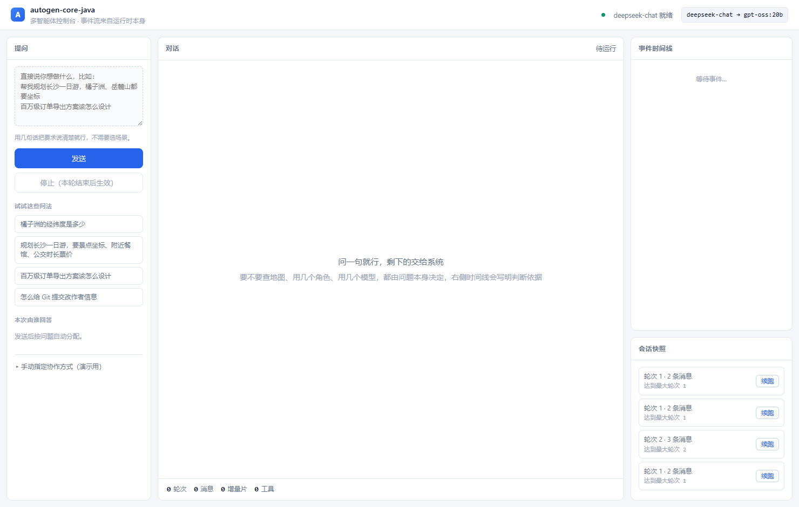
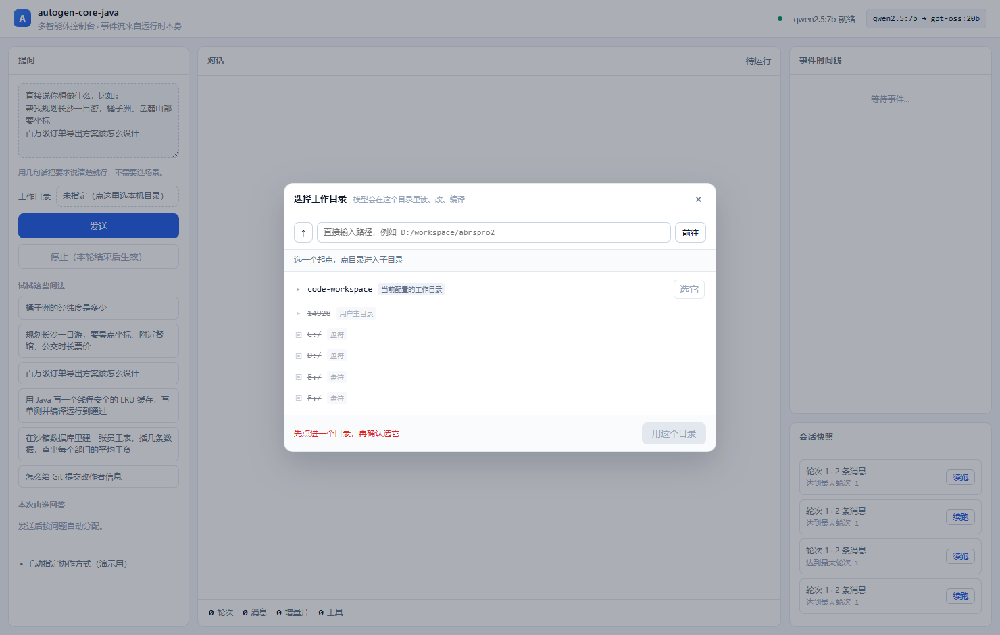
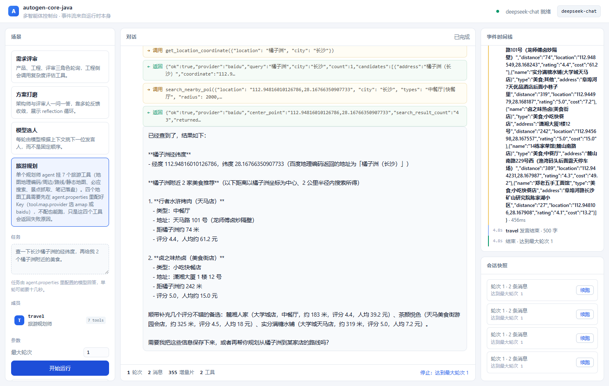
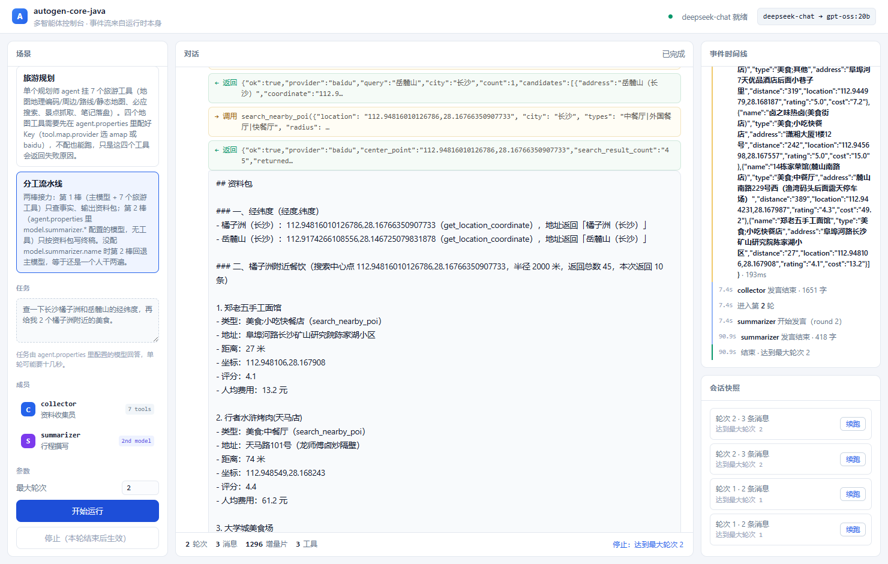
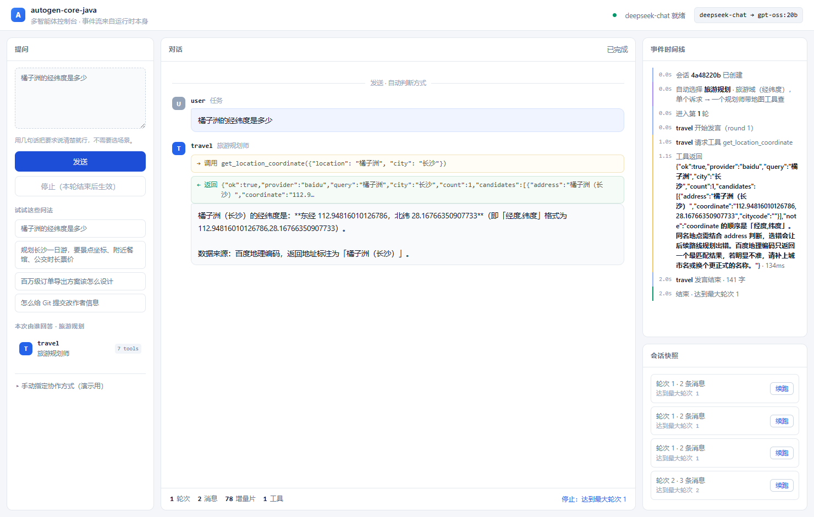
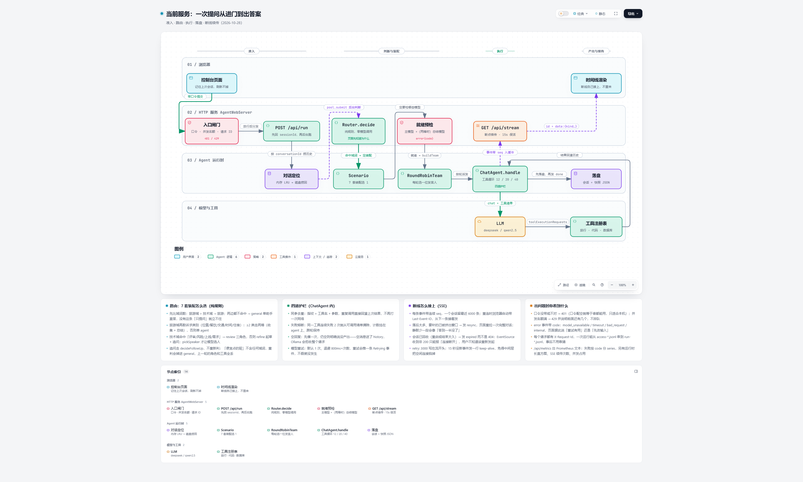
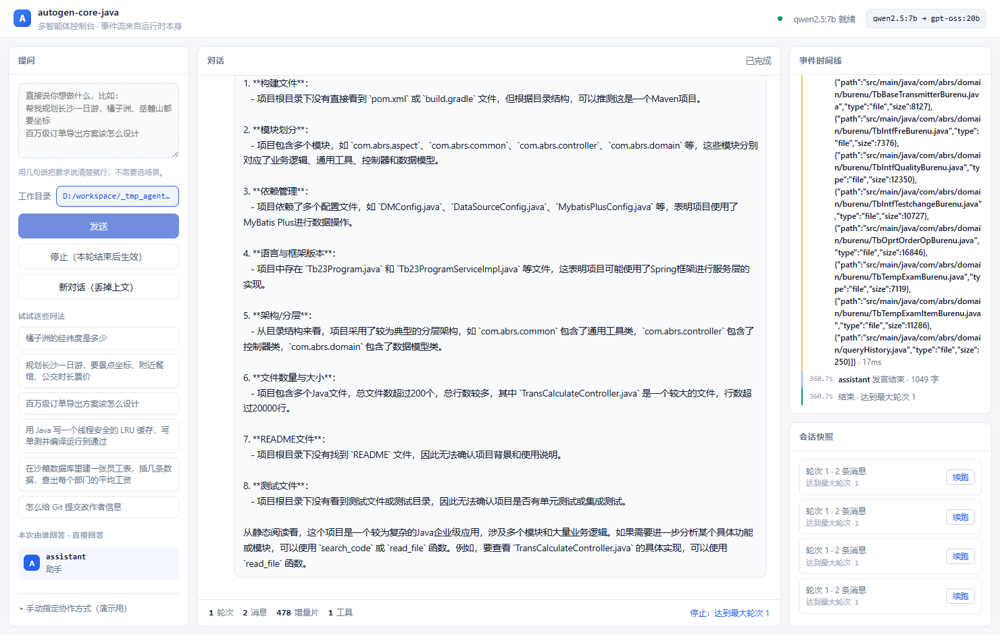

# autogen-core-java

用 Java 复刻 **AutoGen core 的核心机制**：事件驱动的单进程运行时、Topic/Subscription 路由、可组合终止条件、群聊编排、工具调用事件流，外加 **流式输出**、**快照断点续跑**，以及一个**能直接看见这些机制的可视化控制台**。模型层与工具层直接复用 **LangChain4j**，不重写 HTTP 客户端。

> 这不是 AutoGen 的移植，而是一次"机制等价性"验证：把 Python 侧的设计决策逐条翻译成 Java 惯用写法，并用离线 Mock 断言它们真的成立。
>
> **模型默认跑本机 Ollama**（如 `qwen2.5:7b`），全程不出网、不产生费用；云端 DeepSeek 保留为可切换选项。

## 一、与 AutoGen 的概念对照

| AutoGen | 本项目 | 说明 |
| --- | --- | --- |
| `SingleThreadedAgentRuntime` | `AgentRuntime` | 单进程、无并发，`publish` 入队 + `drain` 处理 |
| `AgentID(type, key)` | `AgentId` | record，`toString` 为 `type/key` |
| `Topic = (Type, Source)` | `Topic` | 构造时校验 Type 命名与 Source 非空 |
| `TypeSubscription` | `Subscription` + `registerFactory` | agent key 取自 topic source，目标不存在时按工厂**自动创建** |
| `BaseAgent` | `AbstractAgent` | `handle(msg, ctx)` |
| `AssistantAgent` | `ChatAgent` | 内含工具循环，`maxToolIterations` 兜底 |
| `BaseChatMessage` | `ChatMsg`（sealed） | `Text` / `Handoff` / `Stop` |
| `BaseAgentEvent` | `AgentEvent`（sealed） | `SpeakingStarted` / `SpeakingFinished` / `TextDelta` / `ToolCallRequested` / `ToolExecuted` |
| `RoundRobinGroupChat` | `RoundRobinTeam` | 固定顺序轮询 |
| `SelectorGroupChat` | `SelectorTeam` | 让模型选下一位发言人，解析失败退回轮询 |
| `TerminationCondition`（11 种 + `&`/`|`） | `StopCondition`（default 方法组合） | `textMention(...).or(maxMessages(...))` |
| `TaskResult` | `TaskResult` | 消息 + 事件 + 停止原因 + 累计轮次 |
| 状态即消息列表 | `SessionState` + `TeamSnapshot` | 序列化共享上下文与事件，恢复时按序重放 |
| `save_state()` / `load_state()` | `team.snapshot(result)` / `team.resume(state)` | 见第八章，含两条与 AutoGen 不同的语义取舍 |
| 流式 chunk | `AgentEvent.TextDelta` + `StreamingChatModel` | 见第九章 |
| Studio / UI | `web/AgentWebServer` + 单页控制台 | 见第十章，SSE 直连事件流 |
| `FunctionTool` + schema 推导 | `ToolRegistry` + `@Tool` | 复用 LangChain4j 的注解与 JSON Schema 生成 |

## 二、快速开始

```bash
cd D:\workspace\autogen-core-java

# 启动控制台：不带参数就是它
mvn -q compile exec:java
#   浏览器打开 http://127.0.0.1:8097

# 也可以打包成可直接运行的 jar（连 target/lib 一起拷走即可）
mvn -q -DskipTests package
java -jar target/autogen-core-java-1.0.0.jar
```

> **安全默认**：默认只监听 `127.0.0.1` 且不鉴权，等于"本机开发模式"。
> 要对外提供，必须同时给 `-Dserver.host=0.0.0.0` 和 `-Dserver.auth-token=<口令>`
> （或环境变量 `SERVER_AUTH_TOKEN`）；只对外不给口令会**直接拒绝启动**。
> 页面上能选的工作目录同样收在白名单内（`tool.code.workspace` /
> `tool.code.writable-dirs` / `tool.code.read-only-dirs`），白名单外的路径一律 403。

## 二之一、Docker 部署（前端已用 React 重写）

控制台（React 前端 + JDK 后端）可打包成单个镜像，本地或服务器一条命令拉起：

```bash
# 构建并后台启动（前端构建 + 打 jar + 跑 JRE 全部在镜像内完成）
# 口令必填：容器绑 0.0.0.0，没有口令会直接拒绝启动
export SERVER_AUTH_TOKEN=$(openssl rand -hex 16)
docker compose up -d --build

# 浏览器打开，首次会让你输入这个口令
#   http://localhost:8097
```

镜像细节、环境变量、容器内如何连宿主机 Ollama、数据卷持久化等，见 **[DOCKER.md](DOCKER.md)**。

服务化相关的三件事已经补齐，各有独立文档：

| 能力 | 一句话 | 文档 |
| --- | --- | --- |
| 会话落库 | 每段对话落 `<data-dir>/conversations/<id>.json`，重启/滚动发布后追问仍带上文；页面刷新自动恢复 | 第十八章末节 + `docs/production-readiness.md` |
| 可观测性 | `GET /api/metrics`（Prometheus）、`X-Request-Id` 贯通、`access-*.jsonl` / `run-*.jsonl` | **[docs/observability.md](docs/observability.md)** |
| 密钥外置 | 配置里只写 `${TOOL_BAIDU_AK:}` 这类占位符；真实值走环境变量或 `agent.local.properties`（已 gitignore） | 第三章 |
| 断线续传 | SSE 每条事件带序号，浏览器重连带 `Last-Event-ID`，服务端从断点补发；补不了会发 `resync`，会话没了发 `expired` | **[docs/api.md](docs/api.md)** 第三节 |
| 接口契约 | `GET /api/openapi.json`（OpenAPI 3.1，可直接导入 Postman/Apifox）；人读版 | **[docs/api.md](docs/api.md)** |
| 失败分类 | `error` 事件带 `code`（模型不可用 / 超时 / 参数不成立 / 内部）+ `requestId`，页面按类型给不同的下一步建议 | **[docs/api.md](docs/api.md)** 第三节 |
| 前端测试 | `cd frontend && npm test`（vitest，29 条：纯函数 / 口令与 401 / SSE 状态 / 失败引导 / DOM id 契约） | — |
| 提示词回归 | 10 条固定任务 + 工具调用下限 + 必须出现的事实值；跑真模型，默认关闭，改提示词时手动开 | **[docs/prompt-regression.md](docs/prompt-regression.md)** |

```bash
# 看指标（要口令）
curl -H "Authorization: Bearer $SERVER_AUTH_TOKEN" http://127.0.0.1:8097/api/metrics

# 接口描述（导进 Postman 就能调）
curl -H "Authorization: Bearer $SERVER_AUTH_TOKEN" http://127.0.0.1:8097/api/openapi.json > openapi.json

# 按 traceId 追一次请求：浏览器响应头 X-Request-Id 就是它
jq -c 'select(.requestId=="1a2b3c4d")' target/logs/*.jsonl
```

内网无 GPU 时一次模型调用可能要好几分钟，页面看起来像卡住——原因、实测数据和调优项见
**[docs/intranet-performance.md](docs/intranet-performance.md)**（`ollama ps` 一栏若是 `100% CPU` 就属于这种情况）。

模型、端口、快照目录全部来自配置文件，见第三章——换模型不用改启动命令。页面上的每次运行都走真实模型，没有离线剧本可选。

```bash
# 不开页面，用配置的模型跑一次群聊，终端里看打字机与工具调用
mvn -q exec:java -Dexec.args="console"

# 旅游规划：单 agent + 7 个旅游工具（需要先配 amap.key，见第十一章）
mvn -q exec:java -Dexec.args="travel"

# 旅游工具自检：绕开模型，逐个真调并打印返回
# 配完 Key 先跑这个——它能区分"Key 没配好"和"模型不给力"
mvn -q exec:java -Dexec.args="tools"

# 以下四个是"机制自检"，用 MockChatServer 当测试替身，不需要模型也不联网
mvn -q exec:java -Dexec.args="mock"        # 轮询团队 + 工具调用 + 发布订阅
mvn -q exec:java -Dexec.args="stream"      # 流式输出，边生成边打印
mvn -q exec:java -Dexec.args="resume"      # 快照落盘 + 断点续跑
mvn -q exec:java -Dexec.args="selector"    # 由模型决定谁发言

# 全量测试（184 条，全部走 MockChatServer，不需要模型也不联网）
mvn -q test
```

## 三、配置：`agent.properties` 是唯一真相

`src/main/resources/agent.properties`（这是打进 jar 的默认值）：

```properties
server.port=8097
server.snapshot-dir=target/snapshots

model.provider=ollama            # ollama | deepseek
model.base-url=                  # 留空 = 按 provider 自动（11434/v1 或 api.deepseek.com/v1）
model.name=                      # 留空 = 按 provider 自动（qwen2.5:7b 或 deepseek-chat）
model.api-key=                   # Ollama 不校验，留空即可；DeepSeek 必填
model.temperature=               # 留空 = 按 provider 默认（0.3 / 0.7）
model.timeout-seconds=           # 留空 = 按 provider 默认（300 / 90）

# 可选的第二套模型：分工流水线场景的总结侧，留空 = 回退主模型（第十四章）
model.summarizer.provider=ollama
model.summarizer.name=gpt-oss:20b

# 工具相关（第十一章）
tool.notes-dir=target/notes
tool.amap.key=                   # 高德 Web 服务 Key，配了才能用地图类工具
tool.attractions.provider=auto   # auto | mafengwo | amap
tool.search.provider=bing        # bing（国内直连） | ddg（原 Python 版行为）

# 写代码工具（第十九章）
tool.code.workspace=target/code-workspace   # 默认工作目录；用户在页面上选了目录就跟着选
tool.code.allow-select=true     # 允许在页面上选本机目录当工作目录（选择即授权）
tool.code.read-only-dirs=       # 只读挂载，逗号分隔：能看、改不进去
tool.code.writable-dirs=        # 额外的可写根，逗号分隔
tool.code.write-protect=true    # 改已有文件必须带 read_file 回传的 sha256
tool.code.command-timeout-seconds=120       # mvn/npm/node 等慢程序自动放宽到 300
```

改配置有三种方式，优先级从高到低：

| 方式 | 例子 | 适用场景 |
| --- | --- | --- |
| 系统属性 | `-Dmodel.name=qwen2.5:14b` | 临时试一个模型，不动文件 |
| 环境变量 | `MODEL_NAME` / `OLLAMA_MODEL` / `DEEPSEEK_API_KEY` | CI 注入密钥，避免写进仓库 |
| 外部文件 | 启动目录放 `agent.properties`，或 `-Dagent.config=D:/conf/agent.properties` | 换机器换环境，不改 jar |

外部文件只覆盖同名项，其余仍取内置默认值；`-Dagent.config` 指向不存在的文件会立刻报错——配置写错不该带病启动。

`model.provider` 只接受 `ollama` 与 `deepseek`，写错（比如 `openai`）会在启动时抛出并指出错误值，不会静默回退。

密钥建议走 `DEEPSEEK_API_KEY` 环境变量，不要把 key 提交进仓库。

`base-url` 与 `name` 留空是刻意的：它们跟着 `provider` 走默认值，**切云端只要改 `provider` 一行 + 给 key**。
早期版本把 Ollama 的地址写死在文件里，结果改成 `provider=deepseek` 后请求还被发到 `127.0.0.1:11434`——
报错信息和"模型没起来"长得一样，很容易查错方向。

切到 DeepSeek 的完整命令（key 不落盘）：

```bash
DEEPSEEK_API_KEY=sk-xxx mvn -q exec:java        # provider 在文件里改，key 靠环境变量
# 或者完全不改文件，用系统属性临时试一次：
mvn -q exec:java -Dmodel.provider=deepseek -Dmodel.api-key=sk-xxx
```

### 同一任务的实测对比（2026-10-26，同一份百度 AK）

任务：「长沙一日游：橘子洲 / 岳麓山 / 月亮岛三个经纬度 + 橘子洲附近美食 + 长沙南站到橘子洲的公交」。

| | 本地 `qwen2.5:7b` | 云端 `deepseek-chat` |
| --- | --- | --- |
| 耗时 | 77 s | **10 s** |
| 工具调用 | 2 次（中途放弃） | **7 次，该查的全查了** |
| 回答长度 | 357 字 | **1317 字** |
| 完成度 | 只答了美食，三个景点坐标与公交方案丢失 | 四段齐全，还指出了「地理编码坐标」与「景区 POI 坐标」的差异 |
| 边界处理 | 基本不声明 | 缺的数据明说「数据源未提供」；公交线路号工具没返回，就写「按常识是地铁 2 号线，以官方 App 为准」 |

结论：**7B 卡在"多工具结果汇总"这一步**——它能调工具，但拿回 7 份 JSON 后只会挑一段复述。
这不是提示词能修的，属于模型能力边界。工具链已经验通，要效果就切 DeepSeek。

## 四、为什么走 Ollama 的 `/v1` 而不是原生 `/api/chat`

Ollama 同时提供原生 API（`/api/chat`，支持 `num_ctx`、`keep_alive` 等）和 OpenAI 兼容 API（`/v1/chat/completions`）。本项目选后者，因为：

1. **同一套客户端切换云端/本地**。`OpenAiChatModel` 只改 `baseUrl` 与 `model` 两个字段，编排代码零改动。
2. **离线 Mock 继续可用**。`MockChatServer` 实现的是 OpenAI 协议（JSON 与 SSE 两种传输都支持），换成本地模型后测试不必重写。
3. **工具调用已验证可用**。实测 `qwen2.5:7b` 经 `/v1` 能正确返回 `finish_reason=tool_calls` 与结构化参数。

代价是拿不到 `num_ctx` 这类 Ollama 专有参数（默认 4096，群聊轮次多时需注意上下文截断）。要控制这些参数，得改用 `langchain4j-ollama` 原生模块。

## 五、本地模型的两个配置差异（不是随手写的默认值）

- **温度 0.3 而非 0.7**：7B 在 0.7 下经常不按格式输出终止词（`APPROVE`），群聊会一直跑满轮次。配置里 `model.temperature` 留空时，`AppConfig` 对 Ollama 取 0.3、对 DeepSeek 取 0.7。
- **超时 5 分钟而非 90 秒**：本地 7B 常跑在 CPU 上，单轮 10–40 秒很常见，90 秒会误判超时。

## 六、实测输出（离线 Mock，`mock` 模式）

```
=== 轮询团队（离线 Mock）===

--- 对话记录 ---
[user     ] 帮我做一个订单导出功能，要求支持百万级数据。
[planner  ] 需求拆解：1) 订单导出接口 2) 权限校验 3) 异步任务与进度查询。
[coder    ] 复杂度评分 1（评估工具给的）。方案：导出走异步任务表，权限在网关层统一校验，进度用轮询接口。
[reviewer ] 方案可行，但缺少幂等设计。APPROVE

--- 事件时间线 ---
 1. round 1 · planner 开始发言
 2. round 1 · planner 发言结束（36 字）
 3. round 2 · coder 开始发言
 4. coder 请求工具 estimateComplexity {"requirement":"订单导出接口，含权限校验与异步任务"}
 5. coder 工具 estimateComplexity 返回 1（2ms）
 6. round 2 · coder 发言结束（39 字）
 7. round 3 · reviewer 开始发言
 8. round 3 · reviewer 发言结束（20 字）

--- 停止原因 ---
命中终止词 APPROVE（来自 reviewer）
成员数=3  事件数=8  消息数=4

=== 发布订阅（Topic / Subscription）===
无订阅：dropped=1，投递 0 条
订阅后：dropped=1，投递 2 条，自动创建 agent 2 个（topic source 即 agent key）
```

`mvn test` 结果：**17 / 17 通过**（`GroupChatTest` 5 + `PersistenceAndStreamingTest` 7 + `WebApiTest` 5）。

核心机制：

| 用例 | 验证的机制 |
| --- | --- |
| `roundRobinStopsOnTextMention` | 轮询顺序 + 文本终止 + 消息来源序列 |
| `toolCallLoopEmitsEventsAndFeedsResultBack` | 工具请求/执行事件，且结果回灌进下一次请求（断言请求体含 `42`） |
| `publishWithoutSubscriptionIsDropped` | 无订阅静默丢弃、订阅后投递 |
| `typeSubscriptionAutoCreatesAgentPerSource` | 多租户下按 source 自动实例化 agent |
| `selectorTeamUsesModelChoice` | 模型选发言人，且只多花一次调度请求 |

流式与持久化：

| 用例 | 验证的机制 |
| --- | --- |
| `streamingEmitsTextDeltasAndMatchesFinalText` | 增量分片逐次到达，拼接等于最终文本 |
| `streamingStillRunsToolLoop` | 流式下 `tool_calls` 被聚合，工具结果照常回灌 |
| `snapshotRoundTrips` | 消息/轮次/停止原因往返一致，流式碎片不入快照 |
| `resumeContinuesFromSnapshot` | 全新 runtime 只靠快照续跑，消息追加、轮次接着数 |
| `restoredHistoryDoesNotRetriggerTextMention` | 历史里的 `APPROVE` 不会让续跑立刻停止 |
| `restoredHistoryDoesNotRetriggerToolCalled` | 历史里的工具调用不会触发 `toolCalled` |
| `resumeWithNewInstruction` | 续跑可追加新指令，插入位置正确 |

页面后端（起真服务、走真 SSE）：

| 用例 | 验证的机制 |
| --- | --- |
| `scenariosDescribeMembersAndTools` | 场景与成员元数据、角色是否带工具 |
| `runStreamsDeltasToolsAndDone` | 增量 / 工具 / done 统计沿 SSE 到达，快照落盘并可列出 |
| `resumeReplaysHistoryThenContinues` | 先回放历史（含轮次）再续跑，轮次递增、消息追加 |
| `customTaskOverridesScenario` | 页面改过的任务原样进入共享上下文 |
| `unknownScenarioReturnsError` | 非法场景返回 500 而非挂起 |

## 七、实测输出（本地 `qwen2.5:7b`，`console` 模式）

真机跑一遍，CPU 推理约 **3.5 分钟**（含模型加载）：

```
Ollama 就绪，本地模型：[gpt-oss-low:latest, gpt-oss:20b, deepseek-r1:8b, … qwen2.5:3b, qwen2.5:7b, deepseek-r1:7b]
=== 本地 Ollama（ollama · qwen2.5:7b @ http://127.0.0.1:11434/v1）===

--- 对话记录 ---
[user     ] 帮我做一个订单导出功能，要求支持百万级数据。
[planner  ] 1. 确定导出格式：CSV/Excel  2. 设计导出接口  3. 数据分页处理 …
[coder    ] （评估复杂度后）方案：创建 API 触发导出，分页 + 索引优化 …
[reviewer ] 存在缺口：进度条未实现、缺少错误处理、SQL 注入风险 …

--- 事件时间线 ---
 4. coder 请求工具 estimateComplexity {"requirement":"1. 确定导出格式…"}
 5. coder 工具 estimateComplexity 返回 5（7ms）
 6. coder 请求工具 add {"a":10000,"b":20000}
 7. coder 工具 add 返回 30000（3ms）
 9. round 3 · reviewer 开始发言
10. round 3 · reviewer 发言结束（480 字）

--- 停止原因 ---
命中终止词 APPROVE（来自 reviewer）
成员数=3  事件数=10  消息数=4
```

**本地模型与云端的两个行为差异**（不是 bug，是模型能力差异）：

1. **工具会被连调多次**：7B 把 `add(10000, 20000)` 也调了一遍，甚至自己写了 Python 代码而不是 Java——系统提示里写清语言要求可以缓解。
2. **`textMention` 会误命中**：reviewer 结尾其实是在*引用*"请回复 APPROVE"，子串匹配就判定终止了。AutoGen 的 `TextMentionTermination` 同样是子串匹配，属同源行为；对本地小模型建议改用"独立成行"的终止判定。

## 八、断点续跑（持久化）

AutoGen 的关键洞察是"**状态就是消息列表**"：没有额外的状态机。所以存档 = 把共享上下文与过程事件序列化，恢复 = 按序重放。

```java
// 存档
TaskResult result = team.run("做一个订单导出功能");
Path file = TeamSnapshot.write(Path.of("snapshots"), "RoundRobinTeam", team.snapshot(result));

// 换个进程、换台机器都行：新建 runtime + 新建 team，只把状态喂进去
SessionState state = TeamSnapshot.read(file);
TaskResult continued = newTeam.resume(state);              // 接着跑
TaskResult revised   = newTeam.resume(state, "再补上监控告警");  // 接着跑 + 追加新指令
```

`resume()` 的关键行为：

- **轮次接着数**（快照里 `round=2`，续跑第一轮就是 `round=3`）；
- **消息追加而非重来**（共享上下文原样保留，成员能看到自己以前说过的话）；
- **`maxRounds` 是累计预算**，续跑消耗同一份额度。想要全新额度就显式调大。

### 与 AutoGen 不同的一处语义选择：终止条件看"新增"还是"全量"

这是续跑最容易踩的坑，也是本项目**主动偏离** AutoGen 的地方。从快照恢复后，历史里往往已经存在 `APPROVE` 或某次工具调用；若终止条件仍按全量判定，续跑会在第一轮立刻停止——等于没续。

所以 `TeamState` 同时提供两套视图：

| 终止条件 | 判定范围 | 理由 |
| --- | --- | --- |
| `textMention` / `sourceMatch` / `toolCalled` | **只看本次运行新增** | 历史命中不应重放 |
| `maxMessages` | **累计总数** | 预算是跨进程的，续跑不能免费 |
| `timeout` | 本次运行计时 | 进程重启后历史耗时无意义 |

首次运行（`restoredCount = 0`）时两种视图等价，所以这一改动对原有行为零影响——`GroupChatTest` 的 5 个用例原样通过即为证据。

### 快照里刻意不存的两样东西

1. **流式增量碎片（`TextDelta`）**。它是渲染用的瞬时流，重放只会重复打印；权威文本在 `SpeakingFinished` 与消息里。
2. **工具调用的中间态**。工具结果只存在于单轮内的模型请求历史里，从不进入共享上下文（这点与 AutoGen 一致）。因此续跑恢复的是**对话层**，不会把上一轮的工具返回值重新喂给模型。

## 九、流式输出

`ChatAgent` 同时支持 `ChatModel` 与 `StreamingChatModel`，工具循环代码完全复用：

```java
ChatAgent.streamingBuilder("coder", config.newStreamingChatModel())
        .tools(new CalculatorTool())
        .build();
```

三个设计决定：

- **异步回调收敛成同步**。编排层按轮串行推进，必须等这一轮真的结束才能选下一位发言人，所以用 `CompletableFuture` 桥接，而不是把 `Team` 改成响应式。
- **最终文本以 `onCompleteResponse` 为准，不是增量拼接**。工具调用轮里模型可能先说半句话再调工具，那段增量不会进入最终回复。事件流给人看，消息给编排用，两者不能混。
- **增量通过 `AgentEvent.TextDelta` 外抛**，配合 `runtime.onEvent(listener)` 就能做打字机效果。注意这个回调发生在模型客户端的 IO 线程：事件表用写时复制，`currentRound` 用 `volatile`。

流式下工具调用依然可用：分片到达的 `tool_calls` 由 LangChain4j 聚合，`onCompleteResponse` 给出完整请求——编排层不需要感知分片细节（`streamingStillRunsToolLoop` 用例断言了这点）。

### 实测输出（本地 `qwen2.5:7b`，流式）

模型已在内存时 **33 秒**跑完 2 轮，共 **113 个增量分片**（终端里就是逐字涌现）：

```
=== 本地 Ollama 流式（ollama · qwen2.5:7b @ http://127.0.0.1:11434/v1）===

[planner ] 1. 异步化处理可以避免导出过程阻塞用户界面，确保用户操作流畅。
2. 处理百万级订单数据耗时较长，异步化可以有效避免系统响应延迟，提升用户体验。
3. 异步化有助于资源优化，防止数据库和服务器因长时间占用而影响其他请求处理效率。

[reviewer] APPROVE
您的方案已经充分说明了异步化处理百万级订单导出的必要性和优势……

--- 摘要 ---
停止原因: 命中终止词 APPROVE（来自 reviewer）
轮次=2  消息数=3  事件数=117（其中流式增量 113 片，工具调用 0 次）
```

对比非流式跑法（第六章，3.5 分钟）：**总耗时接近，差别在观感**——流式下首字几秒内出现，非流式要等整轮结束才有输出。这也是为什么前端几乎一定用流式：它不是让模型变快，而是让等待可见。

注意一个真实行为：reviewer 把 `APPROVE` 写在开头、后面继续解释。`textMention` 是子串匹配，命中即停，所以那段解释照样被记进消息，但不再触发下一轮。想让"只有独立成行才算通过"生效，得换自定义条件（`StopCondition` 是函数式接口，加一个即可）。

## 十、可视化页面

```bash
mvn -q compile exec:java                  # 不带参数即控制台，端口取 agent.properties
mvn -q exec:java -Dexec.args="web 9000"   # 临时换端口（覆盖配置）
java -jar target/autogen-core-java-1.0.0.jar   # 打包后同样不带参数
```

打开 `http://127.0.0.1:8097`：左边写一句话，中间看发言逐字涌现，右边是过程事件与会话快照。



**页面不让你选场景**。要不要挂地图工具、用几个角色、用几个模型，由 `Router` 按问题判断，
判断结果和依据是时间线的第一行（细节见第十五章）。左栏底部折叠着一份手动指定入口，给演示和排查用。

唯一的例外是**工作目录**（第十九章）。它和场景不同：场景选错只是"多挂一个工具"，工作目录选错是
"改到别人的仓库"——所以它必须由人点，而且要让人看见自己点的是哪个目录（左栏常显路径，
不在弹层里点"确定"就不生效）。



页面能做的事：

| 区域 | 能力 |
| --- | --- |
| 左栏 | 提问框（主入口）、示例问法（点一下填入）、**工作目录**（点开选本机目录，写代码场景用）、本次成员列表（自动分配，发言时高亮）、折叠的手动指定与轮次 |
| 中栏 | 打字机式逐字输出、工具调用内联展示（→ 调用 / ← 返回）、轮次与增量片数实时统计 |
| 右栏 | 事件时间线（路由依据、发言、工具、轮次、终止）、会话快照列表与一键续跑 |
| 顶栏 | 只显示当前模型名与就绪状态（绿点/红点），没有"换来源"这种开关——页面永远打真实模型 |

**页面不提供离线剧本**。此前这里可以切到 Mock 回放，代价是任务文本框写了什么都不会影响回答（剧本按队列弹），
极容易被误读成"模型答非所问"。现在只在"模型不可用"时才拦住运行，并把原因写在顶栏，
模型配置见 `agent.properties`；Mock 退化成测试替身（`WebApiTest` 通过 `ModelSource` 注入）。

### 服务端日志

Web 模式下每次运行都会在控制台留一条时间线，与页面右侧的事件时间线一一对应：

```
[15:35:07] [run 9ca97dc1] start 场景=review 来源=ollama/qwen2.5:7b 最大轮次=1 任务=用一句话说明订单导出为什么要异步化。
[15:35:07] [run 9ca97dc1] r1 planner 开始发言
[15:35:11] [run 9ca97dc1] r1 planner 发言结束 · 28 字
[15:35:11] [run 9ca97dc1] done 轮次=1 消息=2 事件=19 增量=17 工具=0 停止=达到最大轮次 1 耗时=3676ms
```

工具调用会多出两行（`→ 调用` / `← 返回`），续跑会多一行 `note 续跑：从 session-xxx.json 恢复`。
异常打一行 `error` 并把栈写到 stderr。想核对此前那次"没有日志"的情况：日志是本次补的，老版本确实一行都没有。

**为什么用 JDK 自带的 `HttpServer`**：这里只需要静态页 + 几个 JSON 接口 + 一条 SSE 长连接。引 Spring Boot 会让启动从 1 秒变成 6 秒、依赖树多出几十个包，换不来任何东西。`MockChatServer` 已经证明这套足够。

**SSE 与事件模型是天然匹配的**：框架本来就产出 `TextDelta` 这类过程事件，浏览器 `EventSource` 直接接，不需要 WebSocket，也不需要轮询。

### 九个事件类型

`RunSession` 把模型事件压成九种，前端只写九个分支：

| kind | 含义 |
| --- | --- |
| `status` | 生命周期（准备模型 / 运行中） |
| `route` | 自动路由的结论：用了哪套协作方式、凭什么 |
| `history` | 历史回放：续跑时整段重建（`append=false`），追问时只报条数（`append=true`） |
| `message` | 一条完整发言（用户任务或非流式回复） |
| `delta` | 流式增量 |
| `event` | 发言开始 / 结束 |
| `tool` | 工具请求与结果 |
| `retry` | 模型调用失败、即将重试（第几次、等多久、为什么） |
| `done` / `error` | 收尾，带统计与快照文件名 |

### 四个实现上必须处理的细节

1. **队列缓冲，而不是"连上再跑"**。`POST /api/run` 立刻返回 sessionId，浏览器随后才建 EventSource，这中间产生的事件不能丢——`RunSession` 用一个无界 `LinkedBlockingQueue` 兜住，天然解决竞态。
2. **按事件真实顺序渲染**。`coder` 是先调工具再说话；如果前端"先建气泡、工具行再往里塞"，就会显示成"先说话再调工具"。所以一个消息块内按到达顺序追加：文本段 → 工具行 → 文本段。
3. **只绑 `127.0.0.1`、快照路径防穿越**。这是本机演示工具，不该暴露到局域网；`resolveSnapshot()` 校验解析后的路径仍在快照目录内，挡掉 `../`。
4. **被脚本绑定的 DOM 必须排在 `<script>` 前面**。工作目录弹层最初写在 `</script>` 之后，`$('wsModal')` 拿到 `null`，
   `init()` 第一行就抛错——整页连场景卡片都不渲染，控制台只有一条 `Cannot read properties of null`。
   这类错不报在缺失的元素上，报在最早用到它的那一行，很容易查错方向。

### 联调脚本

`tools/ui-check.js` 用 Playwright 起真浏览器点一次运行，断言统计数字、抓三张截图（桌面 / 移动 / 流式中帧），并收集控制台报错。跑之前先起服务：

```bash
mvn -q compile exec:java
NODE_PATH=D:/workbuddy/binaries/node/workspace/node_modules node tools/ui-check.js
```

`tools/shot-workspace.js` 专门验工作目录选择器：起点目录数、哪些被拦、`D:/workspace` 子目录有没有
`git/maven` 标记、选中后左栏文字与 `localStorage` 是否一致。上次的产出是
`目录 37 / 带 git 19 / 带 maven 18 / 被拦起点 5`、`页面错误: (无)`——DOM 顺序那个坑就是它先报出来的。

## 十一、旅游工具：从 Python 项目移植

工具来自 LangGraph 专题课里的 Python 版「旅游规划机器人」（`tools/` 目录），逐个改写成 Java 的 `@Tool` 方法，挂在 `com.example.agentcore.tool.travel` 下。工具名保持一致，两边提示词可以互抄。

### 迁移对照

| Python 文件 | Java 实现 | 依赖的外部服务（高德 ｜ 百度） | 要 Key |
| --- | --- | --- | --- |
| `locations.py` → `get_location_coordinate` | `LocationTool` | 地理编码：`/v3/geocode/geo` ｜ `/geocoding/v3/` | ✅ |
| `nearby.py` → `search_nearby_poi` | `NearbyTool` | 周边搜索：`/v3/place/around` ｜ `/place/v2/search` | ✅ |
| `transportation.py` → `route_planning` | `RouteTool` | 公交路线：`/v3/direction/transit/integrated` ｜ `/directionlite/v1/transit` | ✅ |
| `static_map.py` → `get_location_coordinate`（重名） | `StaticMapTool` | 静态图：`/v3/staticmap` ｜ `/staticimage/v2` | ✅ |
| `web_search.py` → `web_search` | `WebSearchTool` | DuckDuckGo（原版）/ 必应 cn（新增，国内直连） | ❌ |
| `attractions.py` → `get_attractions_information` | `AttractionsTool` | 马蜂窝网页 / 地图 POI（降级路径） | ❌ / ✅ |
| `save.py` → `save_info_and_clear_history` | `TravelNotebookTool` | 本地文件 | ❌ |

技术替换：`requests` → JDK `HttpClient`；`bs4`/`lxml` → Jsoup；`selenium` → Jsoup 直连（见下）；`duckduckgo_search` → 直接抓搜索页。

### 地图服务商：高德 / 百度，改一行配置切换

四个地图工具不直接绑定某一家，而是走 `MapClient` 接口的两个实现（`AmapClient` / `BaiduClient`）：

```properties
tool.map.provider=amap   # 或 baidu
tool.amap.key=           # provider=amap 时用
tool.baidu.ak=           # provider=baidu 时用
```

工具名、参数说明、返回字段两家完全一致，**换 provider 不需要改提示词、不需要改前端**。写错成别的值会直接报配置错误，而不是悄悄退回高德——静默降级会让人排查半天"填了百度 AK 却在报高德的错"。

能这样换的关键是 `MapClient` 上的**坐标契约**：入参出参一律「经度,纬度」+ GCJ-02。高德原生就是这套；百度原生是 BD-09 + 「纬度,经度」，由 `BaiduClient` 内部用 `coord_type=gcj02` / `ret_coordtype=gcj02ll` 做双向转换。所以同一份坐标可以在两家之间直接混用。

### 百度的四+一个坑（都在 `BaiduClient` 里消化掉了）

| 坑 | 高德 | 百度 | 处理方式 |
| --- | --- | --- | --- |
| **坐标顺序** | 一律「经度,纬度」 | `place` / `directionlite` 要**「纬度,经度」**，但 `staticimage` 的 `center` 又要「经度,纬度」 | 一个平台内部两种顺序，按接口分别转 |
| **坐标系** | GCJ-02 | BD-09（默认） | 请求带 `coord_type=gcj02`、`ret_coordtype=gcj02ll`，与高德统一 |
| **同名参数不同取值** | — | `ret_coordtype`：`place`/`geocoding` 认 `gcj02ll`，`directionlite` **只认 `gcj02`**（传 `gcj02ll` 直接 `status=2 format is invalid`）；`coord_type`：`place` 要数字 `2`，`direction` 要字符串 `gcj02` | 三个接口分别写，`BaiduClientHttpTest` 有断言锁住 |
| **成功码** | `status=1` 成功 | `status=0` 成功，**且失败时 HTTP 照样是 200** | 只认 body 里的 `status==0`；只看 HTTP 状态码会把"AK 无效"当成功 |
| **返回形状** | `location` 是 `"112.93,28.22"` 字符串 | `location` 是 `{lat,lng}` 对象 | 统一转回字符串，否则下游解析直接崩 |

第 3 条是实测撞出来的，也最阴：`geocoding/v3` 传错 `ret_coordtype` **不报错**，静默忽略并返回 BD-09。实测同一地址带 `gcj02ll` 得 `112.9174,28.1467`，带 `gcj02` 得 `112.9238,28.1531`（后者其实是 BD-09）——差 800 米，但接口一声不吭。

### 百度的能力差异（如实保留，不硬凑）

| 项 | 高德 | 百度 |
| --- | --- | --- |
| 地理编码结果 | 返回同名候选列表 | **只返回一个最匹配结果**（`geocode` 至多 1 条） |
| 出租车费 / 总步行距离 | 直接给 `taxi_cost`、`distance` | 没有独立字段，取出租车方案里的估算总价，取不到就留空 |
| POI 分类参数 | `types`（「中餐厅」「宾馆酒店」） | 没有 `types`，只有 `tag`（「美食」「酒店」）；`BaiduClient` 内部做了词表映射 |
| 单页条数 | `offset` 可到 25 | `page_size` 最大 20，页码从 **0** 开始 |

### Key 申请：高德

1. 注册/登录 <https://lbs.amap.com/>
2. 进控制台 **应用管理**：<https://console.amap.com/dev/key/app>
3. 右上角「创建新应用」，名称随意，类型选「其他」
4. 在该应用下点「添加 Key」——**服务平台必须选「Web服务」**
5. 把 Key 填进 `agent.properties` 的 `tool.amap.key`（或环境变量 `TOOL_AMAP_KEY`）

第 4 步最容易踩坑：选成「Web端(JS API)」「Android」「iOS」都会在调用时返回 `USERKEY_PLAT_NOMATCH`，但 Key 本身是能建出来的，很容易以为自己填错了。用错类型时本项目的错误信息会直接把这条提示出来。

### Key 申请：百度

1. 注册/登录 <https://lbsyun.baidu.com/>，控制台 <https://lbsyun.baidu.com/apiconsole/key>
2. 「创建应用」——**应用类型选「服务端」**（选「浏览器端」报 `status=220` Referer 校验失败，选 Android/iOS 报 `203`）
3. 该应用下「添加 AK」，勾上要用的服务：地理编码、地点检索、公交路线规划、静态图
4. 校验方式二选一：
   - **IP 白名单**：填出口 IP。家用宽带是动态 IP，变了就会报 `status=210`；本地调试可临时填 `0.0.0.0/0`
   - SN 校验：要在请求里带 `sn` 签名，本项目**未实现**，别选这个
5. 填 `agent.properties` 的 `tool.baidu.ak`（或环境变量 `TOOL_BAIDU_AK`），并把 `tool.map.provider` 改成 `baidu`

配额要留意（个人开发者，官方「开发者权益」页）：地理编码 5000/日、路线规划 5000/日、静态图 5000/日，但**地点检索只有 100 次/日**。旅游场景里周边搜索和景点降级都吃这个额度，调试时很容易撞 `status=302` 天配额超限。额度不够可以去做个人开发者认证，或继续用高德。

四家能力都能覆盖工具的原始需求，选哪家只取决于你手上有哪个 Key。

### 拿到 AK 后先分清两件事：AK 对不对、IP 通不通

百度的错误码很容易把人带偏：**AK 无效和 IP 不在白名单，HTTP 状态都是 200**，只能看 body 里的 `status`。

| 你看到的 | 真实含义 | 该做什么 |
| --- | --- | --- |
| `status=210` APP IP校验失败 | AK 是**有效的**，只是请求方 IP 不在白名单 | 查本机出口 IP（`curl myip.ipip.net`）→ 控制台编辑 AK → 加进白名单 |
| `status=200/201/202/203` | AK 不存在 / 被禁用 / 校验方式不对 | 核对 AK 字符串、应用类型是否「服务端」 |
| `status=240` | AK 没勾选这个服务 | 控制台应用里勾上对应接口 |
| `status=302` | 天配额超限 | 地点检索个人只有 100 次/日 |
| `status=4` | 配额耗尽 | 同上 |

实测记录：同一串 AK 打两家可以瞬间判定归属——高德返回 `INVALID_USER_KEY / 10001`，百度返回 `210`，说明它是百度的 AK 且需要走 IP 白名单。

还有一点值得记住：**地图工具全挂时，模型会自己编坐标**。实测 `get_location_coordinate` 返回 210 后，模型会自动降级 `web_search`，搜索也没给坐标，于是它输出了「经度 113.0189, 纬度 28.1855」这种看起来像真的、但是猜出来的数字。所以 AK 没通时跑出来的行程只能看流程，不能看数据。

### 与原版的三处行为差异（都是有意为之）

1. **马蜂窝改直连，并带降级路径**。原版用 Selenium 开真浏览器，是为了过马蜂窝的 WAF。实测纯 HTTP 客户端请求搜索页会拿到 `202 + JS 挑战页`，Jsoup 无法执行 JS。所以 `get_attractions_information` 做成两个数据源：先抓马蜂窝（字段全：简介/游玩时长/开放时间），被拦就自动退到高德 POI 检索（稳定、带坐标，但没有开放时间和时长），返回里的 `source` 字段会写明数据来自哪条路。要强制指定用 `tool.attractions.provider`。
2. **静态地图改名 `get_static_map_image`**。原版 `static_map.py` 里的函数也叫 `get_location_coordinate`，和 `locations.py` 重名；在 LangGraph 里挂两个同名工具会互相覆盖。原版 `tools/__init__.py` 也没导出它，等于死代码——这里补进工具清单并改名。
3. **信息保存真的落盘**。原版用 `response_format="content_and_artifact"`，正文塞进 tool message 的 artifact 字段交给上层 state，因为 LangGraph 的工具改不了图状态。Java 版没有 artifact 通道，与其照抄一个"说了保存其实没保存"的空壳，不如真的追加写入 `target/notes/travel-notes.md`，并把文件路径返回给模型。

### 工具名与 Java 方法名解耦

`@Tool(name = "get_location_coordinate")` 让工具名保持 snake_case（与 Python 版一致），Java 方法名仍是 `getLocationCoordinate`。为此 `ToolRegistry` 改成用 `ToolSpecification.name()` 而不是 `Method.getName()` 做索引——否则模型回传的是规格名，按方法名查会永远查不到。`TravelToolsTest` 里有这条的回归用例。

### 工具熔断（缺 Key 时不让小模型打转）

实测：没配地图 Key 时，本地 7B 会在 `get_location_coordinate`（必然失败）和 `web_search` 之间来回横跳，把每轮工具预算全耗在同一个坏工具上。提示词里写"换个工具"对它无效。

所以 `ChatAgent` 里加了熔断：同一工具连续失败 2 次就从工具列表里摘掉，并往上下文插一条说明。计数挂在 agent 实例上，跨轮保持。配上 Key 后工具能正常返回，熔断不会触发。

### 同参重复调用拦截

工具通了之后暴露另一个毛病：7B 会把 `get_location_coordinate("岳麓山","长沙")` 用**一模一样的参数**连调三轮，白烧轮次预算。

`ChatAgent` 记下「工具名 + 参数」的指纹，第二次起不再真的发请求，直接回一条「你已经用相同参数查过，结果没变，请用上一次的结果继续」。只记成功的调用——失败的要允许换参数重试（那是熔断器的活）。`RepeatedToolCallTest` 锁住两条：同参拦截、异参放行。

效果：同一个场景从 4 次工具调用降到 2 次，耗时 116s → 93s。

### 空回复不能当答案，更不能进历史

7B 在「上下文里已经有答案」时会回一条空消息：`content` 为 null、也没有 tool_calls。原先这种回复落进 `if (reply == null)` 的兜底，被报成「已达工具调用上限 12 次」——一次工具都没调，却让人去查工具循环，方向全错。

现在分三步：① 催一句「你上一条回复是空的，请直接给出最终回答」重试一次；② 仍是空回复就如实说「模型连续两次返回空回复」，不栽给工具上限；③ **空消息绝不写进 history**——Ollama 会以 `invalid message content type: <nil>` 把整个请求打回（这点踩过，整个 run 直接 500）。`EmptyReplyTest` 直接断言第二次请求的 messages 里没有空 content 的 assistant 消息。

### 实测记录（没有 Key 的情况）

`mvn exec:java -Dexec.args="tools"`：

```
地图服务: 高德开放平台（amap）   Key/AK: (未配置)
          未配置 → 下面 4 个地图工具会失败。申请地址：
          https://console.amap.com/dev/key/app
  [FAIL] get_location_coordinate    4ms  未配置高德 Key。请到 https://console.amap.com/dev/key/app 申请（服务平台必须选「Web服务」）…
  [OK]   web_search               596ms  {"ok":true,"provider":"bing","query":"长沙 岳麓山 开放时间","returned":3,…}
  [OK]   get_attractions_information 67ms  {"ok":false,…"马蜂窝抓取失败：返回 HTTP 202…","高德开放平台 POI 检索失败：未配置高德 Key…"}
  [OK]   save_info_and_clear_history 28ms  {"ok":true,"file":"…/target/notes/travel-notes.md"}
```

用假 Key 探测时四个高德接口全部连通并正确翻译错误（`INVALID_USER_KEY / infocode=10001`），说明 URL 拼装与链路无问题，只等真 Key。

百度侧用假 AK 同样跑过一遍（`TOOL_MAP_PROVIDER=baidu TOOL_BAIDU_AK=… mvn exec:java -Dexec.args="tools"`），四个接口全部连通：

```
地图服务: 百度地图开放平台（baidu）   Key/AK: abcd****3456
  [FAIL] get_location_coordinate   311ms  百度 /geocoding/v3/ 返回失败：APP不存在，AK有误请检查再重试（status=200）。AK 无效或被禁用，确认应用类型是「服务端」…
  [FAIL] search_nearby_poi          34ms  百度 /place/v2/search 返回失败：…（status=200）…
  [FAIL] route_planning             35ms  百度 /directionlite/v1/transit 返回失败：…（status=200）…
  [FAIL] get_static_map_image       40ms  百度 staticimage 未返回图片（HTTP 200，Content-Type text/html）…
```

这四条"失败"正是预期结果——假 AK 被服务端拒绝，说明**四个 URL 都拼对了、都连上了**，且错误码 200 被正确识别为"AK 有问题"（而不是当成成功）。

参数顺序这类真正容易错的东西，靠本地 HTTP 桩验证（`BaiduClientHttpTest`，6 个用例，不联网）：拦下真实发出的请求，断言 `place`/`direction` 的 `location` 是 `lat,lng`、`staticimage` 的 `center` 是 `lng,lat`、`page_num` 已从 1 基转成 0 基、`scope=2` 与 `coord_type=2` 都在、`中餐厅` 已映射成 `美食`；再用真实响应结构断言 `location:{lat,lng}` 被转回「经度,纬度」字符串。

### 配好真 AK 之后的实测（百度）

```
地图服务: 百度地图开放平台（baidu）   Key/AK: uhK0****Ba87

  [OK] get_location_coordinate  315ms  {"ok":true,"provider":"baidu","query":"岳麓山","city":"长沙","count":1,
                                        "candidates":[{"coordinate":"112.9174266108556,28.146725079831878"}]}
  [OK] search_nearby_poi        148ms  {"ok":true,"center_point":"112.938814,28.228209","returned":5,…}
  [OK] route_planning           384ms  {"ok":true,"origin":"112.938814,28.228209","options":[{"cost":"4","duration":"3839"}]}
  [OK] get_static_map_image     110ms  {"ok":true,"file":"…/target/notes/maps/112_938814_28_228209.png","bytes":49139}
  [OK] web_search               364ms  {"ok":true,"provider":"bing","returned":3,…}
  [OK] get_attractions_information 162ms {"ok":true,"source":"baidu-poi","scenic_count":3,…}
  [OK] save_info_and_clear_history 23ms {"ok":true,"file":"…/target/notes/travel-notes.md"}
```

7 个工具全通。换成 `deepseek-chat` 后跑「长沙一日游（三景点坐标 + 橘子洲美食 + 长沙南站到橘子洲）」：7 次工具、10 秒、1317 字，四段内容齐全；缺的字段（开放时间、公交线路号）会明说「数据源未提供」「按常识是 2 号线，以官方 App 为准」，不编。同一个任务给本地 `qwen2.5:7b` 是 77 秒 / 357 字，只答了美食一段——**工具链没问题，瓶颈在模型的汇总能力**（对比见第三章）。



页面顶栏会直接显示当前 provider 与模型名，换模型不用改启动命令。配了第二套模型时，
chip 会显示成 `deepseek-chat → gpt-oss:20b`，一眼能看出这次是分工跑。

### 场景与验证入口

页面上默认不选场景：写一句话，由 `Router` 判断走哪条路（见第十五章）。下面这些入口仍然可用，
折叠区的「手动指定协作方式」就是它们的可视化版本。

- 「旅游规划」：单 agent + 全套 7 个工具，`maxRounds=1`。**曾经是 3**，实测发现单 agent 多轮等于让它把同一个问题重答三遍——第 2 轮模型会丢掉工具刚查到的坐标，自己另编一个（112.9174 → 113.0089）。一次 `handle` 内部本来就有工具循环（最多 12 次），单轮足够查完多组数据。
- 「分工流水线」：collector（主模型 + 7 工具）→ summarizer（第二套模型，无工具），`maxRounds=2`。轮询顺序即流水线顺序，别改成 1——那会只跑收集、不跑总结。细节见第十四章。
- `/api/health` 多返回 `mapProvider` / `mapName` / `mapApplyUrl` / `mapKeyField` / `mapReady` 几个字段，页面据此在没配 Key 时给出对应服务商的申请地址与配置项名，而不是等运行失败。
- `maxToolIterations=12`：一个目的地要挨个查景点坐标，默认 5 次不够。

## 十二、必须在代码里修的一个环境坑：系统代理

这不是可选项。JDK 的 `HttpClient` 默认用 `ProxySelector.getDefault()`，Windows 上会读系统（IE/注册表）代理。机器上一旦配了全局代理，发往 `127.0.0.1:11434` 的请求也会被送进代理，现象是**连接看似建立、永远收不到响应**，或者直接 `ConnectException`。

容易误判的地方在于：`curl http://127.0.0.1:11434/...` 一直是通的（curl 对 localhost 有内建豁免），于是看起来像"服务没问题、是 Java 代码写错了"。

`ProxySupport.bypassProxyForLocalhost()` 只对回环地址禁代理，其余地址仍走原选择器，所以云端 DeepSeek 不受影响。`ModelConfig.newChatModel()`、`newStreamingChatModel()` 与 `OllamaProbe` 都已调用。

## 十三、结构

```
src/main/java/com/example/agentcore/
├── messaging/          Topic · ChatMsg(sealed) · AgentEvent(sealed，含 TextDelta)
├── runtime/            AgentRuntime · AgentId · Subscription · AgentContext · SessionState
├── agent/              AbstractAgent · ChatAgent(流式/非流式) · ToolRegistry · EchoAgent
├── team/               Team · RoundRobinTeam · SelectorTeam · TaskResult
├── termination/        StopCondition · TeamState
├── tool/               CalculatorTool
│                       travel/  ← 从 Python 旅游规划机器人移植的 7 个工具
│                         MapClient(地图服务商接口) · MapClients(按配置选 amap/baidu)
│                         AmapClient(高德 HTTP/错误翻译) · BaiduClient(百度 HTTP/坐标与错误码转译)
│                         WebFetcher(网页抓取)
│                         LocationTool · NearbyTool · RouteTool · StaticMapTool
│                         WebSearchTool(必应/DDG) · AttractionsTool(马蜂窝→地图 POI 降级)
│                         TravelNotebookTool · TravelPrompt · TravelTools
│                       code/   ← 写代码的 11 个工具（第十九章）
│                         CodeWorkspace(多根，每个根可写或只读 + 系统目录拦截)
│                         CodeFilesTool(list_files/read_file/read_dir/write_file/edit_file/search_code)
│                         CodeCommandTool(白名单 shell + 超时分类) · Platform(cmd/sh/powershell)
│                         Executables(可执行文件探测) · CodePrompt(场景提示词) · CodeTools(装配)
│                       db/     ← DB_TOOLS
│                         DbConnections(登记连接与只读开关) · DbTool(schema/query/execute)
├── web/                AgentWebServer(SSE 路由 + /api/fs/list 目录浏览) · ModelSource(模型注入点)
│                       RunSession(事件翻译与队列) · Scenario(预设场景) · RunLog(服务端日志)
├── support/            AppConfig · ModelConfig · OllamaProbe · ProxySupport · MockChatServer
│                       TeamSnapshot · RetryPolicy · RetryableToolError(参数错≠工具坏)
└── Main.java           无参数=web；console / travel / tools / mock / stream / resume / selector

src/main/resources/agent.properties    运行配置：端口、快照目录、模型端点、工具边界（唯一真相）
src/main/resources/web/index.html      单页控制台（无构建步骤、无前端依赖，含工作目录选择器）
tools/ui-check.js                      Playwright 联调脚本（点一次运行 + 截图 + 收集报错）
tools/run-coding.py                    命令行跑一次 coding 场景（可传本地目录当工作目录）
tools/shot-workspace.js                验工作目录选择器（起点数 / 被拦 / 标记 / localStorage）
docs/coding-tools.md                   写代码工具的完整设计说明与实测记录
```

## 十四、分角色：一个模型查、另一个模型写

单 agent 的瓶颈在上一章已经暴露清楚了：**工具全调通，回答却只覆盖了一段**。所以这里把一件事拆成两棒：

```
用户任务
  ↓
collector（主模型 deepseek-chat + 7 个旅游工具）  ← 只查，不写结论
  ↓  资料包（原始事实 + 每条的来源工具）
summarizer（model.summarizer 配置的模型，无工具）  ← 只写，不新增事实
  ↓
最终回答
```

配置上就是两套模型，第二套不配就回退主模型（单模型行为一个字不变）：

```properties
model.provider=deepseek            # 收集侧：工具调用准、快
model.api-key=sk-xxx

model.summarizer.provider=ollama   # 总结侧：本地 20B，不需要工具
model.summarizer.name=gpt-oss:20b
model.summarizer.timeout-seconds=600
model.summarizer.temperature=0.4
```

### 为什么这样拆

分工的价值不在"两个模型"，而在**约束**。同一份数据，两种角色要守的规矩是相反的：

| | collector | summarizer |
| --- | --- | --- |
| 能做什么 | 调工具、抄数据、标来源 | 组织语言、排版、按问题裁剪 |
| 不能做什么 | 下结论、写建议、替用户判断 | 补常识、估算、改数字、编字段 |
| 缺数据时 | 写「未返回」 | 写「未查到」 |
| 输出长度 | 长（本次 2132 字） | 短（本次 634 字，压掉 70%） |

如果收集侧顺手把结论也写了，总结侧就只剩润色——分工白做，而且两段回答会互相打架。
所以 `COLLECTOR_SYSTEM` 里是硬性禁令："你交的是原始素材，排版和取舍由下一位同事负责。"

反过来，总结侧最大的风险是**它会把空字段填满**。所以 `SUMMARIZER_SYSTEM` 明确禁止用常识补，
并要求名称、坐标、评分、人均、距离、时长、票价"必须与资料包完全一致，不许改小数位、不许把精确值改写成约"。

### 实测（DeepSeek 收集 + 本地 gpt-oss:20b 总结）

任务：三景点坐标 + 橘子洲附近 3 家餐馆 + 长沙南站到橘子洲的公交时长票价。

```
[08:51:43] note 分工：收集 deepseek-chat → 总结 gpt-oss:20b（ollama）
[08:51:55] r1 collector 发言结束 · 2132 字      ← 6 次工具，12 秒
[08:53:41] r2 summarizer 发言结束 · 634 字      ← 106 秒（纯 CPU）
[08:53:41] done 轮次=2 消息=3 工具=6 耗时=117351ms
```

质量上三条都守住了：
1. **数字零漂移**。`112.94816010126786,28.16766350907733` 这种 15 位小数原样过去，没有被"约等于"改写；
2. **没填空**。公交只返回了时长和票价、没给线路号，总结侧写的是「仅有一条公交方案，未提供具体线路或换乘信息」——而不是自己补一句"坐地铁 2 号线"；
3. **按约束裁剪**。用户只要 3 家餐馆，收集侧给了 10 家，总结侧只列 3 家。

### 那让同一个模型跑两棒呢？

上面这组对比混了两个变量：**拆成两棒**，和**换了个模型**。为了把两者分开，用同一份提示词、
同一个任务再跑一组「两棒都是 deepseek-chat」（`MODEL_SUMMARIZER_*` 全部指向 deepseek）：

| 组合 | 耗时 | 终稿字数 | 工具 | 回答里有什么 |
| --- | --- | --- | --- | --- |
| 单 agent `deepseek-chat` | **10 s** | **1317** | 7 | 坐标（地理编码 + 景区 POI 双坐标）、游览顺序建议、**8 家**餐馆、公交时长票价 + "通常走 2 号线"提示 |
| 两棒 都是 `deepseek-chat` | 13 s | 885 | 6 | 坐标、**刚好 3 家**餐馆、公交时长票价、明确列出 4 项"未查到" |
| 两棒 `deepseek-chat` + `gpt-oss:20b` | 117 s | 634 | 6 | 同上一行，但更短、更保守 |

同模型分工只多花 3 秒，就把「严格服从约束 + 主动标注缺口」这两件事拿到了：用户要 3 家，
它真的只给 3 家，并且额外列出"岳麓山、月亮岛的门票/开放时间/景点间通行：本次未调用，未返回"。
单 agent 则给了 8 家、外加一段用户没要的游览顺序建议。

但代价同样具体：**丢掉 432 字有用信息**（游览顺序、双坐标对照、常识提示）。
这些恰恰是"人会把疑问补一句"的部分。

所以三个选项的真实取舍是：

- **单模型**：信息最全、最主动、最快。适合模型本身够强、你要它替用户多想一步的场合；
- **两棒同模型**：只多一次几十毫秒到几秒的往返，换来"听话 + 留痕（collector 的原始素材包可审计）"。
  适合格式/合规要求严格、不许自由发挥的输出；
- **两棒异构**：只有在两个模型**能力互补且互相不可替代**时才划算。
  这次的 20B 并不互补——它只是"免费的 deepseek"，慢了 9 倍、少写 250 字，质量没有提升。

换句话说，**分工的收益来自约束，而约束不必靠换模型获得**。想省 token 或数据不许出网时，
再考虑异构那一档；指望"换个模型来提升总结质量"，这组数据里没有出现。



### 三个坑

1. **模型预检要在第一棒之前做**。总结模型要到第 2 轮才用到，如果等它自己失败，
   第一棒查数据的 12 秒和 6 次工具配额已经烧掉了。所以 `launch` 里先 `Readiness.of(summarizer)`，
   不通就直接报错并指出该改哪一项。
2. **`/api/tags` 不能算进请求计数**。`MockChatServer.requestCount()` 的语义是"调了几次模型"，
   就绪探测会先打一次原生 `/api/tags`；混进去会让"两个角色各调一次"的断言全部失真。
   Mock 里单独处理这条路径，并用 `declareModel()` 声明自己有哪些模型。
3. **本地大模型的超时要单独配**。20B 纯 CPU 写六百多字要 106 秒，沿用小模型的 300 秒虽然够，
   但写一千字以上就会擦边。`model.summarizer.timeout-seconds=600` 是刻意的。

### 什么时候不该用

- 收集量小（一两个工具调用）：两棒的分工收益小于多一次模型往返的开销，直接用单 agent；
- 总结模型比收集模型弱很多：弱模型照抄会失真，反而比单 agent 差——这也是把 `summarizer`
  做成可选、默认回退主模型的原因。

## 十五、自动路由：用户只提问，不选场景

前十四节里所有场景都是**演给别人看的**：先点一张卡片，再点运行。真实用法不会这样——
用户不知道也不关心"你们内部有几套协作方式"，他只会说"帮我规划长沙一日游"。

所以现在页面只有一个输入框。走哪条路由 `Router` 决定，结论与依据作为第一条事件
推给页面（时间线第一行）：

```
0.0s  自动选择 旅游规划 · 旅游域（经纬度），单个诉求 → 一个规划师带地图工具查
```




### 判定规则

分两步：先定"域"，再定"形式"。

| 输入信号 | 落点 |
| --- | --- |
| 旅游域，且只涉及一类诉求 | `travel`：一个规划师 + 7 个地图工具 |
| 旅游域，涉及两类以上诉求（位置 / 餐饮 / 交通 / 时间 / 住宿） | `travel-pipeline`：先查素材，再写终稿 |
| 技术议题 + "评审/风险/上线/需求" | `review`：产品拆解 → 工程估算 → 评审把关 |
| 技术议题，只要初稿 | `refine`：架构师起草 + 评审人追问 |
| 代码任务（写一个 / 单测 / 编译 / 报错 / 建表插数据，或点名到某个源码文件） | `coding`：编码工程师带 11 个本地工具（含数据库、批量读目录），改完自己编译验证 |
| 都不命中 | `general`：单个助手直接回答 |

两个域都有命中时按命中词数比较，平局归技术。**域词表里刻意不收"路线""方案"这类会被另一域借走的词**——
"设计一条长沙两日游路线"必须判成旅游，靠的是"两日游"这种不可共用的词，不是靠数量硬压。

### 为什么是规则，不是让模型选

1. **快**：`Router.decide` 是纯字符串匹配，微秒级；让模型选要多一次调用，用户点完按钮先等 3 秒才看到"我要派三个人"。
2. **可解释**：用户有权知道"凭什么给我派三个 agent"。规则能直接把命中的词说出来，日志里也留着，事后能复查；
   模型给的理由是编的，看起来合理但不可验证。
3. **错了也不致命**：所有路径都能回答，路由错的后果是"形式不对"而不是"答不上来"。

### 必须补的兜底：`general`

没有 `general` 这条路径，"用户只提问"根本立不住——总有问题落不进任何场景。
问"怎么给 Git 提交改作者信息"时，把 7 个旅游工具挂上去是错的，用三角色评审也是错的。

它的提示词刻意写得保守：**没有联网、没有地图，涉及实时信息不肯凭记忆编**。
这比让它编一个像样的答案重要——通用助手的失败模式不是答得短，是答得自信而错误。

但这条例外必须写清楚边界。最初的写法是"凡涉及实时信息都直说'我无法确认最新值'"，结果
**3B 模型把这句现成话当成了万能挡箭牌**：问"流式调用最多等多久"，它一次工具都不调，
直接回"我无法确认最新值"——这句话在提示词里是个太顺手的模板。现在改成"先看手上有什么，
项目里的事实先去查；只有真要联网的实时信息才说查不到"。回归集里 10 条任务有 3 条正是
栽在这句话上（见 [docs/prompt-regression.md](docs/prompt-regression.md)）。

一处例外：**用户在页面上选了工作目录时，这条兜底路径会额外获得 4 个只读文件工具**，因为
"分析一下这个项目"这种问题没有域词、必然落在这里，而没有工具就只能回"我看不到你的项目"。
写工具与命令工具不会给它——它这一轮的定位是"看和说"，不是"改"。细节见第十九章 19.6。

### 实测

`tools/route-check.py` 批量打 `/api/run`（不带 `scenario`），只读路由结果：

```bash
python tools/route-check.py
```

| 问题 | 判成 | 耗时 | 工具 |
| --- | --- | --- | --- |
| 橘子洲的经纬度是多少 | `travel` | 3.0 s | 1 |
| 帮我做一个订单导出功能，要求支持百万级数据 | `review` | 4.8 s | 1 |
| 设计一个百万级订单的导出方案 | `refine` | 3.5 s | 0 |
| 怎么给 Git 提交改作者信息 | `general` | 4.2 s | 0 |
| 一日游 + 景点坐标 + 附近餐馆 + 公交票价 | `travel-pipeline` | 120 s | 5 |

最后一条 120 秒不是因为路由慢，而是因为它派给了第二套模型（本地 `gpt-oss:20b` 纯 CPU 写终稿），
见第十四章。**路由把"要不要付这个 106 秒"的决策从用户手里接了过来**，这正是它该做的事。

### 手动指定还留着

左栏底部折叠着「手动指定协作方式（演示用）」，六个场景都在，点一下切换、再点一下回到自动。
它不再是主路径，只是给演示和排查用的——`/api/run?scenario=review` 这类调用也仍然有效。

自动模式下页面上的「最大轮次」不生效（轮次跟场景走）。这是有意的：`travel` 如果被填成 4 轮，
第 2 轮起模型会丢掉工具刚查到的坐标自己另编，具体实测见第十一章。

### 处理流程全景

加进路由之后，一次任务的实际链路是：**页面提交 → `Router.decide` 定装配 → 预检 → `RoundRobinTeam` 派发 → 工具循环 → 快照 + 事件流回页面**。
图是 archify 技能按 `workflow` 类型生成的，四道门禁（validate / deliver / check / browser-check）全过：



交互版：[`docs/archify-service-flow.html`](docs/archify-service-flow.html)（单文件自包含，`?` 看快捷键，`R` 追两点间路径，`F` 进演示态）。
源稿在 `.archify/workflow-service-flow-20261028-1630/candidate.json`，改流程时改它再重跑 `finalize`。

图上覆盖的链路是：**页面提交 → 入口闸门（口令 / 并发名额 / 请求 ID）→ `Router.decide` 定装配 → 就绪预检 → `RoundRobinTeam` 派发 → 工具循环 → 先落盘再发 done → SSE 断点续传**。

两处读图时容易被误读的地方：

- **`Router` 与 `Scenario` 分两个节点**：前者是"判成哪一类"（纯规则），后者是"这类装配成什么样"（角色、工具、轮次）。
  同一列上下排布表示前者决定后者，不是两个并行步骤。
- **事件不走主路径**：`runtime.onEvent` 把事件外抛给 `RunSession` 队列，再由 `/api/stream` 推给页面，
  与主路径是并行的两条线；`route` 事件更早，是 `launch()` 里直接推的，所以页面在模型开口之前就显示"本次由谁回答"。

> 环境记录（在本机生成这张图时踩到的两件事，都不是 archify 的 bug）：
>
> 1. **archify 的原子交付依赖 `link → unlink → 校验 nlink == 1`**，而 WorkBuddy 的
>    `node-safe-delete-shim` 会把 `fs.unlinkSync` 改写成"移入回收站"（rename 语义），
>    inode 链接数不释放，于是发布必报 `candidate has multiple hard-link names`。
>    该 shim 对 `os.tmpdir()` 下的路径会绕过（走原生 unlink），所以**把工作目录放在
>    系统临时目录里就能过**，不必去 D 盘的项目目录里硬扛。
> 2. **本机的 Google Chrome 起不来**（`spawn UNKNOWN`），需要 `ARCHIFY_CHROME`
>    指向 Playwright 自带的 chromium，否则 `browser-check` 过不去。

### 已知局限

- **词表是手工维护的**。中文没有空格分词，这里用 `contains` 硬匹配，代价是维护成本：加一类问题就要加几个词。
  上线规模再大就该换成小模型分类或 embedding 最近邻，但那是另一套成本和另一套不确定性，演示项目不值得。
- **判不出"轻微技术 + 轻微旅游"的混合问题**（例如"把行程存成 Excel 该用什么库"），会归到技术侧。
- `pick`（模型选人）刻意不参与自动路由：它演示的是 `SelectorTeam`，对用户没有实际收益。

## 十六、三个刻意的取舍

1. **编排自己写，不用 `langchain4j-agentic`**。后者的 `supervisorBuilder` 语义最接近 AutoGen，但仍是 beta，且发言人选择完全交给模型，离线测试不可控。本项目把编排压到约 250 行，换来"每一步都可断言"；模型层与工具层仍然全部复用 LangChain4j。
2. **单线程，不做线程池**。AutoGen 的 `SingleThreadedAgentRuntime` 本来就是串行处理消息队列。要并发时只需把 `drain()` 换成虚拟线程调度，语义不变。流式回调虽然跨线程，但只做事件外抛，不参与编排决策。
3. **工具执行不做沙箱**。演示工具是纯计算，直接反射调用。真实场景要执行模型生成的代码，必须上容器隔离（docker-java / Testcontainers）+ 资源与网络限制，这部分是安全工程，不是框架功能。
4. **前端不引框架**。单页 HTML + 原生 `EventSource`，没有 npm、没有构建步骤。这套东西的目的是**看见机制**，不是做产品；真要做产品时，事件协议（九种 kind）比 UI 技术栈更值得保留。

## 十七、未实现（有意留白）

- 分布式运行时（Host Servicer / Worker / Gateway）与跨语言 worker；
- `Swarm` 的 `HandoffMessage` 路由（`ChatMsg.Handoff` 已定义，尚未接入选择逻辑）；
- token 用量终止（`ChatResponse.tokenUsage()` 已可取，尚未做累计）；
- 持久化到数据库（当前是 JSON 文件，`SessionState` 换成 JPA 实体即可，但没做）；
- 落盘快照的保留策略（`snapshots/*.json` 只写不删，`TeamSnapshot.latest()` 只有"取最新一份"；
  运行中的会话已经会按闲置时间回收，落盘的还没有）；
- 快照的版本迁移（`version` 字段已写入，尚未实现旧版本升级路径）；
- 页面上的鉴权与多用户隔离（现在只绑本机回环，按单用户设计）；
- **工作目录选择没有身份概念**：谁打开这个页面，谁就能选本机目录（本机单用户前提下成立，多人共用一台机器就不成立）；
- **写保护只管文件工具**：`sha256` 拦的是 `edit_file`/`write_file`，拦不住 `run_command` 里 `mvn`/`java`
  执行任意字节码、或 `git checkout -- .` 把改动抹掉。白名单挡的是"明显危险的首词"，不是沙箱隔离；
- **`around` 只认 Java 系的大括号**：表达式体方法（Kotlin/Scala）、C 宏、缩进敏感语言需要各自的配对规则；
- 流式断线续传（`Last-Event-ID` 重放，现在断线需重开一次运行）。

## 十八、多轮对话与重试：把"能答一次"变成"能一直用"

第十五章的自动路由解决了"用户不用选场景"，但还有两个洞，都是真拿它当工具时立刻会踩到的：

1. **每次提问都是新会话**。`/api/run` 一律 `newSession()`，用户问完"长沙一日游"再问"那附近有什么好吃的"，
   系统会把第二句当成全新问题——上一轮查到的坐标、推荐过的餐馆、用过的工具全丢。这不是模型不聪明，
   是我们没把上文递过去。
2. **模型错一次，整轮作废**。全仓 `grep retry` 是空的：模型端一次 503 或连接抖动，前面十几秒的等待、
   十几次工具调用、几十次 POI 检索全部白烧，用户只能重来一遍。

### 多轮怎么接上

新增 `Conversation`（`web/Conversation.java`）作为跨 run 的上下文，`/api/run` 多认一个 `conversationId`：

```
POST /api/run?task=...                        → {sessionId, conversationId, followUp:false}  新对话
POST /api/run?task=...&conversationId=abc123  → {sessionId, conversationId, followUp:true}   追问
```

三个不能省的点：

- **轮次要归零**。`Team.maxRounds` 是累计预算，`resume()` 会从快照的 `round` 接着数。
  不归零的话，第二轮一进来就是"达到最大轮次 1"，一个字都不出。`Conversation.carryOver()`
  返回的就是"消息照旧、轮次 0"的一份副本。
- **只存消息，不存事件**。流式增量和工具事件是渲染用的，重放只会重复打印；接着聊需要的只有"谁说了什么"。
  同时这也控制住了体积：十轮对话的事件能到几 MB，消息只有几十 KB。
- **追问不能重新路由**。这是最容易被忽略的一条："那第二个呢""便宜点的呢""附近有什么好吃的"
  单独拎出来什么域词都不命中，重新 `decide()` 会掉进 `general`，上一轮的工具和角色全丢。
  所以有了 `Router.decideFollowUp(current, task)`：**默认沿用上一轮的装配**，只有新一轮明确落在另一个域
  且命中够强（≥2 个词）才换。用户第一轮问旅游、第二轮突然问"帮我设计一个百万级订单导出方案"，
  换到技术侧是对的；只蹦出一个"方案"两个字就换人，后面还得再换回来，来回抖比不换更糟。

页面上：跑完之后输入框保留、直接再发就是追问，左栏出现「新对话（丢掉上文）」；
追问时**不重绘对话区**（`history` 事件的 `append=true` 只带条数），只加一条分隔线和一行时间线。

> 会话存内存不落盘。重启之后旧 `conversationId` 会退化成新对话（页面不会卡在死 id 上）。
> 这是有意选的最简方案：要跨重启就得处理并发写和清理，而落盘那套已经有快照了。

### 重试的边界

`RetryPolicy` 只做一件事：判断"这个异常值不值得再试一次"。不自己解析状态码，直接用 LangChain4j 的分类：

| 情况 | 判定 | 原因 |
| --- | --- | --- |
| 429 限流、5xx、超时 | 重试 | `RetriableException` 的子类，退避后常常就过了 |
| 401 鉴权、400 参数错、模型不存在 | 不重试 | `NonRetriableException`，重试一百次也一样，只会把错误藏起来 |
| 连接被重置、读超时 | 重试 | JDK 网络异常，多半是瞬时故障 |
| **流式已经吐出过字** | 不重试 | 重来会让同一段文字在页面上出现两遍，比直接报错更让人困惑 |

最后一条是设计上的关键取舍：**能安全重试的只有"一个字都没吐出来就失败"**（连接失败、首包超时、503），
而这恰好是绝大多数失败。已经输出了半句再断开，直接把错误交给用户，让他决定重发。

重试次数默认 **1**，不是 3：一次失败已经等完了超时（云端 90 秒），再叠三次重试会让用户等五六分钟
还以为卡死了。真正的网络抖动 1 次足够覆盖。重试作为 `kind=retry` 事件外抛，页面上直接显示
"第 1/1 次重试 · 原因"，否则重试期间页面和卡死没有区别。

### 实测

三轮追问（`python tools/multi-turn-check.py`，DeepSeek + 百度地图）：

```
第 1 问：橘子洲的经纬度是多少
  路由 travel · 2.8s · 1 次工具 · 上下文 2 条
第 2 问：那第二个呢            ← 单看这句会判成 general
  追问 · 沿用「旅游规划」· 本轮没有更强的换域信号 · 2.6s · 1 次工具 · 上下文 4 条
第 3 问：附近有什么好吃的
  追问 · 沿用「旅游规划」· 本轮仍属旅游域 · 5.2s · 1 次工具 · 上下文 6 条
```

关键证据不是"回答看着像接着聊"，而是**第三轮的工具请求里 `center_point` 就是第一轮查到的坐标**
（`112.94816010126786,28.16766350907733`）——模型知道自己说的"附近"是哪儿。第二轮的回复也能证明：
它去查了"橘子洲在长沙的所有同名地点"，然后说"只有一条记录，所以第二个没有数据可给"，而不是自己编一个。

重试用真实 HTTP 503 验证（本地桩返回 503，服务端 `model.max-retries=1`）：

```
data: {"kind":"retry","agent":"assistant","attempt":1,"maxRetries":1,"delayMillis":800,
       "reason":"流式调用失败（启动流式请求）: {...\"server_error\"}"}
data: {"kind":"error","message":"..."}
桩收到 2 次 POST  → 证明重试真的发出了第二次请求，不是只打了个日志
```

页面验证：`node tools/shot-multiturn.js`，两轮跑完消息数 2 → 4（没清屏）、
时间线有「接着这段对话」、页面零错误，截图 `docs/console-multiturn.png`。

### 顺手补的：会话内存回收

之前 `sessions` 只 `put` 从不 `remove`：每个 RunSession 连同它队列里攒下的事件会一直留在内存里，
服务开一天就攒一天。现在超过 64 个时清理"已终态且闲置 30 分钟"的；多轮上下文按
`web.max-conversations`（默认 32）做 LRU。

### 配置

```properties
model.max-retries=1          # 0 = 不重试（排查"偶发还是必然"时用）
model.retry-backoff-ms=800   # 第 n 次重试等 n 倍
web.max-conversations=32     # 多轮上下文同时保留几段
```

测试 **80/80**：新增 `RetryPolicyTest`（10）、`ChatAgentRetryTest`（5，含"流式已输出不重试"）、
`RouterTest` 多轮 5 条、`WebApiTest` 多轮 3 条（追问带上文 / 换话题切域 / 过期 id 优雅退化成新对话）。

## 十九、写代码：11 个本地工具 + 可选工作目录 + 跨平台命令

前面所有场景的产出都在聊天记录里；`coding` 不一样，它的产出**在磁盘上**——判成功的标准是
`run_command` 的 `exitCode` 是不是 0，不是回答看起来对不对。

| 工具 | 作用 | 少了它会怎样 |
| --- | --- | --- |
| `list_files` | 递归列目录（跳过 target/.git/node_modules） | 凭空造目录、覆盖已有文件 |
| `read_file` | 带行号读文本，可按区间取；`around=方法名` 按符号定位；回传 `sha256` | 凭记忆改代码 |
| `read_dir` | **批量读一个目录**：glob 过滤，一次返回多个文件内容（默认 20 个 / 每个 120 行，附 `notRead` 提示） | 读一个包要十几次 `read_file`，轮次全花在搬文件上 |
| `write_file` | 新建 / 整体覆盖，自动建父目录；覆盖已有文件必须带 `sha256` | 什么都写不出来 |
| `edit_file` | 精确局部替换，锚点必须唯一，必须带 `sha256`，CRLF 自动对齐 | 改一行要重写整个文件，长文件必被截断 |
| `search_code` | 正则搜代码，返回 文件:行号:内容；`offset` 翻页 | 靠猜文件名逐个读 |
| `run_command` | 编译 / 测试 / 运行，返回退出码与输出；`mvn/npm/node` 等默认 300 秒 | 只能说"应该能跑" |
| `db_connections` | 有哪些库可连、是否可写 | 不知道往哪连 |
| `db_schema` | 表清单 / 列名类型主键 | 列名靠猜，SQL 跑起来才发现对不上 |
| `db_query` | 只读查询（只放行 SELECT/WITH/SHOW/DESC/EXPLAIN） | SQL 只能说"看着像对" |
| `db_execute` | 建表 / 插入 / 更新 / 删除 | 造不出测试数据 |

### 19.1 工作目录：用户选，不是钉死的沙箱

**写**路径曾经钉死在 `tool.code.workspace`（默认 `target/code-workspace`，`mvn clean` 就清掉）；
现在 `CodeWorkspace` 是**多根**模型——每个根记着自己可写还是只读，第一个可写根是主根。
`tool.code.workspace` 退化成"用户没选时的默认值"。

```
GET  /api/fs/list?path=D:/workspace     → 列子目录（只列目录、不读内容，带 git/maven 标记）
POST /api/run?scenario=coding&workspace=D:/workspace/abrspro2
```

页面左栏有「工作目录」，点开是弹层：上跳、手输路径、列表点选，选完存 localStorage，
本次 run 把选中的目录当**主根（可写）**，`list_files` / `read_dir` / `search_code` 不带参数就从它开始。

为什么这么做而不是"再放开一个可写目录配置"：`tool.code.read-only-dirs` 那种配置要求用户改
properties 再重启，而"我要改哪个仓库"是每次都不一样的事。让用户在页面上点，**选择本身就是授权**——
模型碰不到 URL 参数，也就没法自己扩权。

挡住的还是挡住：盘符根（`C:\`）、用户主目录本身（会连桌面、文档、`.ssh` 一起交出去）、
`C:\Windows`、`/etc` 这些由 `CodeWorkspace.rejectReason()` 统一判，页面上标红点不进去，接口直接 400。
`tool.code.allow-select=false` 可以整条关掉，退回"只用配置里写的目录"。

### 19.2 可控写入：不是"放开写"，是"可追溯地写"

| 机制 | 做法 | 挡的是什么 |
| --- | --- | --- |
| 哈希写保护 | `read_file` 回传 `sha256`；`edit_file` 和"覆盖已有文件"的 `write_file` 必须带回，不一致即拒 | 文件在"它看完之后"被别人改过，它照着旧内容覆盖 |
| git 回显 | 写后返回 `{"repo","file","status","added","deleted"}` | "我以为改了一行，其实删了 300 行" |
| 开工先看 `git status --short` | 提示词强制 | 把别人的在途改动混进自己的 diff |

`tool.code.write-protect=false` 可以关掉哈希校验（只给测试用，生产别关）。

### 19.3 容量：让"读一个真实文件"变得可行

- `read_file around=方法名`：按符号定位，大括号配对到方法结尾，**同名重载合并区间**
  （实测 `circuitQuality` 有两个重载，只给第一个会让它改错地方）；按符号读不再谎报 `truncated`。
- `search_code offset`：一次 60 条 + `nextOffset`，不用靠换关键词绕上限（会漏）。
- `run_command` 超时按程序分类：`mvn/gradle/npm/node/go/dotnet` 默认 **300 秒**，其余取配置的 120。
- `maxToolIterations` 30 → **40**：改存量工程时读文件占大头。

### 19.4 其余边界没松

命令走**白名单**（javac/java/mvn/node/python/git 等）而不是黑名单；白名单内的破坏性操作
（`rm -rf`、`git push`、`git reset --hard`、`--no-verify`）另外拒掉；数据库只能连登记过的连接名，
真实库默认只读，H2 的 `RUNSCRIPT/ATTACH/CSVREAD/CREATE ALIAS` 这类"用 SQL 读文件/执行 Java"的后门点名禁掉。

**Windows 与 Linux 分开处理**。平台是一等参数（`Platform`），不是散落的 `if`：

| | Windows（cmd） | Linux/macOS（sh） |
| --- | --- | --- |
| 看目录 | `dir /b` | `ls -l` |
| 看文件 / 搜内容 | `type` / `findstr` | `cat` / `grep -rn` |
| 通配符 | 不展开（`javac *.java` 失败） | shell 展开 |
| 编码 | 先 `chcp 65001`，否则中文报错乱码 | 默认 UTF-8 |

白名单跟着**本次实际用的 shell** 走：cmd 放 `dir/type/findstr`，POSIX 放 `ls/cat/grep`，
PowerShell（`ls`/`cat` 都是别名）两边都放。写错平台时不是回一句"不允许"，而是直接给本平台的
等价写法（`ls -l` → `dir /b`），并提示本机装了 Git Bash 时也可以传 `shell="bash"` 用原命令。
`cmd`/`powershell` 本身不在白名单里，`xargs`/`find -delete`/`sed -i` 也拒——这些是"首词检查"挡不住的套壳绕过。

### 19.5 参数错 ≠ 工具坏

**参数级失败不该算工具坏**。锚点没对上、`sha256` 过期，这类是模型自己能修好的，走
`RetryableToolError` → `{"ok":false,"retryable":true}`，**不进熔断计数**（`ChatAgent` 只对 `ERROR`
前缀累计，其余清零）。起因是它连续两次锚点失配后 `edit_file` 被禁，转头去写 python 脚本按字节改文件——
工具没坏，是它没找到锚点。

### 19.6 分析类问题：一副"只读的眼睛"

实测里最难看的回答不是改错代码，是这个：

> 用户（已在页面上选了 `D:/workspace/abrspro2`）：**分析一下这个项目**
> 助手：你没有贴出项目内容……**我这次没有文件系统和工具权限，读不到**，需要你把内容贴进来。

三重原因叠在一起：这句话不含任何技术域词（"项目"不是域词）→ 路由落到 `general`；
`general` 的 `toolset` 是 `none`；它的提示词里还写着"你这次没有联网、没有地图、没有工具"。
三处都指向"我看不到"，而用户明明已经把目录交出来了。

改法是给"本来不挂工具"的场景补一副**只读**的眼睛，跑一次就能看出差别：

| | 修复前 | 修复后 |
| --- | --- | --- |
| 路由 | general | general（没变，这句话确实没有域词） |
| 工具 | 0 个 | `list_files` / `read_dir` / `read_file` / `search_code` |
| 工具调用 | 0 次 | **17 次**（list_files ×6、read_file ×5、read_dir ×2、search_code ×2 …） |
| 耗时 | 2.4s | 29.2s |
| 回答 | "请补充材料" | 模块划分、7 个数据源与 Mapper 包对应表、巨型类实测行数、"`mysql2` 实际连的是达梦"这类只有读到配置才说得出的结论 |

三件事必须一起做，少一件就回到原样：

1. **工具裁到方法级**。`ToolRegistry.subset("list_files","read_dir","read_file","search_code")`——
   写工具**不进 schema**，不是"挂上去再拒绝"。挂上去就等于告诉模型它能写，它一定会试。
2. **能力按"这一轮有没有选目录"叠加**，而不是写死在场景里。`general`、`review`、`refine` 的
   `toolset` 仍然是 `none`；用户在页面上选了目录，`AgentWebServer` 才给这些成员挂只读工具
   （`maxToolIterations` 给 20——读一个真实项目十几个文件是常态）。
3. **提示词分清"没权限"和"没指定"**。没有目录时说"你还没指定目录，请用左栏「工作目录」选一个"，
   不要说"你没有文件系统权限"——后者是假的，还会让用户以为这条路走不通。

顺带把页面左栏默认文案从"默认沙箱（由服务端配置）"改成"未指定（点这里选本机目录）"：
没选目录时确实没有可看的目录，写"默认沙箱"会让人以为已经能看东西了。

实测十一轮（DeepSeek `deepseek-chat`，自动路由）。前六轮是沙箱从零写，7–10 轮是真实的 abrspro2 副本，
第 11 轮是"只读分析"：

| # | 任务 | 耗时 | 调用 | 结果 |
| --- | --- | --- | --- | --- |
| 1 | 从零写 LRU + 自测 | 36.7s | 16 | 编译一次过，最终 `PASS` |
| 2 | 从零搭 Maven 工程 + JUnit | 28.0s | 12 | `mvn test` 5 用例全绿 |
| 3 | 修预置 bug（`average` 分母 +1） | 6.6s | 5 | 只改 1 行，`PASS` |
| 4 | 沙箱建表 + 插 5 行 + 分组统计 | 8.9s | 6 | 研发部 19750 手算一致 |
| 5 | 写 Java 连同一个库查出均值 | 10.8s | 8 | `PASS`（独立复核也 PASS） |
| 6 | 连本机达梦 DM8 看表取数 | 9.6s | 5 | 137 张表，`FXYP.TB_BASE_STATION` 前 5 行 |
| 7 | 只读分析 `around=applyUnqualifiedPercentForToday` | 10.3s | 3 | 一次命中方法体（95–97 行），13 处引用全核对 |
| 8 | 修 `circuitQuality` 的 `until()` 同日得 0 天 | 39.4s | 12 | 改成 `between()+1`，`mvn -o -q compile` 退出码 0（22.2s） |
| 9 | 给方法补 javadoc（**CRLF 修复前**） | 95.1s | 22 | 锚点连续失配 → 熔断 → 改用 python 按字节改，留 2 个删不掉的临时文件 |
| 10 | 同一个 javadoc 任务（**修复后**） | 38.1s | 7 | 一次改成功，`git.added=23/deleted=1` 与 `git diff --stat` 一致，无残留 |
| 11 | **分析整个项目**（`分析一下这个项目`，路由到 general） | 29.2s | 17 | 全程只读；给出 7 个数据源与 Mapper 包的对应表、巨型类实测行数、"`mysql2` 实际连达梦"；结尾主动声明"没编译没运行，不下结论" |

第 9、10 轮是同一任务的对照：**95.1s / 22 次 → 38.1s / 7 次**。第 10 轮它还原地报告了
"第 32 行仍是 `until()`，没有 +1，注释写的是预期口径，两者不一致；那是逻辑改动，没你确认我没动"。

> 全程在 `D:/workspace/_tmp_agent_ws/abrspro2_probe`（`git init` 后的副本）里做，
> 原仓库 `abrspro2` 的 `git status` 与开工前完全一致，一个字没动。



（DeepSeek 限流期间用本机 `ollama · qwen2.5:7b` 复跑同一句话截的：路由落 general、
时间线全是 `list_files`/`read_file`/`search_code`、无任何写工具；本地 7b 慢，跑了约 6 分钟、
回答 1049 字，结论与第 11 轮一致。）

过程中修掉的五个问题：

1. **"改完再跑一遍"被同参重复调用拦截挡掉**——编译→报错→改→再编译是编码的常态，而第二次编译的
   命令一个字都没变。修法是给状态记版本号：工具用 `MutatingTool` 声明哪些方法有副作用，
   写文件成功后版本号加一，指纹里记着当时的版本，版本变过就放行。
2. **点名到源码文件的修复请求被路由去"讨论怎么修"**——`src/Calc.java 里的 average 算错了…改到输出 PASS`
   只命中一个「实现」，被判成技术议题。补了两条：源码扩展名本身是强信号；词汇补 `修复/修好/改到/跑不起来`。
3. **数据库任务被判成"讨论方案"**——"建一张表…查出来"里没有任何代码域词，`isCoding` 直接否掉；
   顺带发现 `normalize` 抹掉所有空白，词表里 `create table` 这种带空格的词永远匹配不上。
   修法：强信号补数据库动词、强信号不要求先命中代码域词、匹配时把词也压一遍空白。
4. **`edit_file` 对 CRLF 完全不宽容**——文件是 CRLF、模型用 `\n` 拼锚点，逐字符 `indexOf` 必然失配。
   Windows 项目上失败率接近 100%，而这是"改存量工程"的第一个动作。修法：匹配前把锚点的换行符
   调成文件风格，写回时保持一致（否则 git diff 整段变色）。
5. **参数错把工具熔断掉了**——连续两次 `old_text` 对不上，`edit_file` 被禁，模型转去写 python
   脚本按字节改文件，还留下两个 `del` 不掉的临时脚本。参数错 ≠ 工具坏，于是拆出
   `RetryableToolError`（见 19.5）。

另有两个只在真跑里暴露的解析坑：`git -C <文件所在目录>` 拼出重复路径 → 吐
`could not open directory` 但**退出码仍是 0**，`-C` 必须是仓库根；Windows `autocrlf` 的
`warning:` 走 stderr、合并后被当成 `--numstat` 第一行，`added` 解析成空——读 git 输出必须过滤 `warning:`。

详见 [docs/coding-tools.md](docs/coding-tools.md)。测试 **145/145**，本轮新增/改写：
`CodeToolsTest` 扩到 21 条（`around` 单符号 / 同名重载、`search_code` 分页、CRLF 宽容匹配、
`edit_file` 缺哈希/旧哈希/多锚点/无锚点四条拒绝路径）、`CodeWorkspaceRootsTest` 6 条
（用户选目录可写、只读根仍拒写、额外可写根、越界拦截、系统目录拦截、null 回退配置）、
`CodeFilesToolGitTest` 1 条（`added/deleted` 与 `??` 新文件）、`RetryableToolFailureTest` 1 条
（连续 3 次参数错后工具仍在）、`ToolRegistrySubsetTest` 4 条（schema 里只剩读方法、子集外的名字
调不动、子集仍能读、未知名忽略）、`WebApiTest` 加 `workspaceSelectablePerRun` /
`analysisTaskGetsReadOnlyFileTools` / `analysisWithoutWorkspaceAsksForDirectory` /
`reviewScenarioAlsoSeesWorkspaceReadOnly`。

`read_dir` 和只读目录仍留着，用途变成"看但不动"：配 `-Dtool.code.read-only-dirs=D:/workspace/xxx`
就能读那个项目，写进去照样被拒。实测一次调用读完 3 个 `.md`（该目录 100 个匹配，回 `notRead=97`
和"用 glob 缩小范围"的提示），紧接着的越界写入被拒、文件未被碰过。

上一轮还抓到过一个**只有真跑才暴露的装配 bug**：`AgentWebServer` 里直接用
`CodeTools.all(appConfig.codeWorkspace(), …)` 构造工具，而只读目录只存在于
`CodeWorkspace.fromConfig()` 里——配置写了等于没写，模型拿到的是"路径越界"。
改成 fromConfig 并加了配置读取的测试钉住。这一轮的同类风险是 `coding` 场景忘了把
用户选的目录传进 `CodeWorkspace.forUserSelection()`，于是提示词说"工作目录是 A"、工具却认 B；
`WebApiTest.workspaceSelectablePerRun` 就是钉这个的。

页面这一侧用 Playwright 实测（`tools/shot-workspace.js`）：起点目录 37 个、带 git 标记 19 个、
带 maven 标记 18 个、被拦的起点 5 个；选 `abrspro2` 后左栏显示 `D:/workspace/abrspro2`、
localStorage 同步、页面零报错。截图见 `docs/console-workspace-*.png`。
